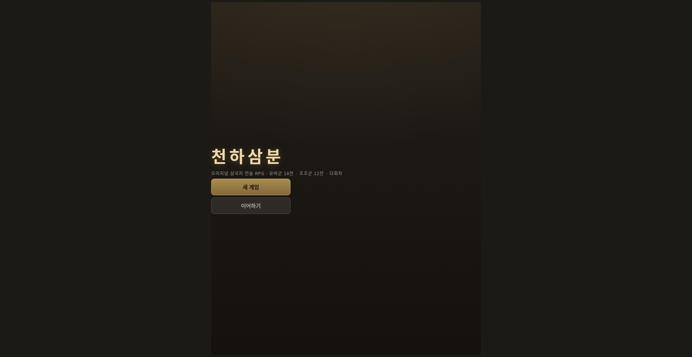
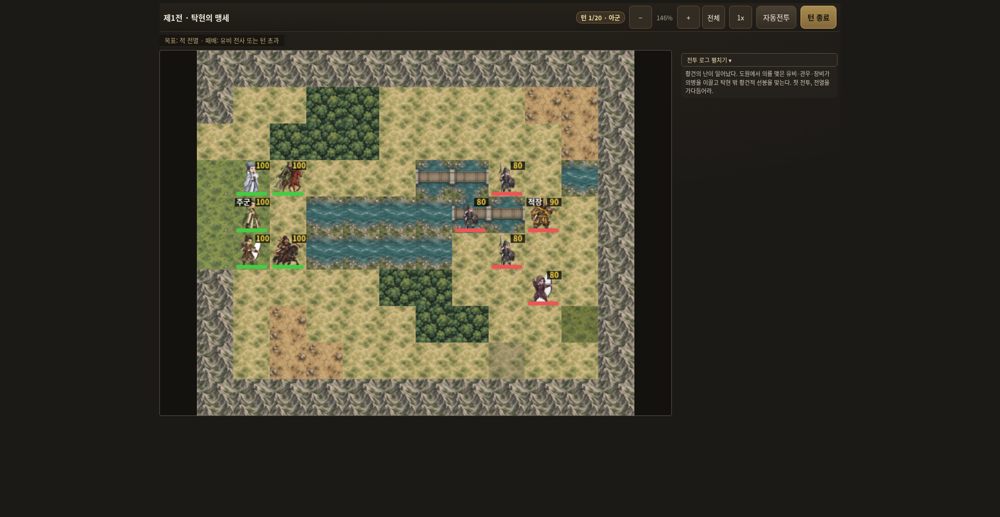
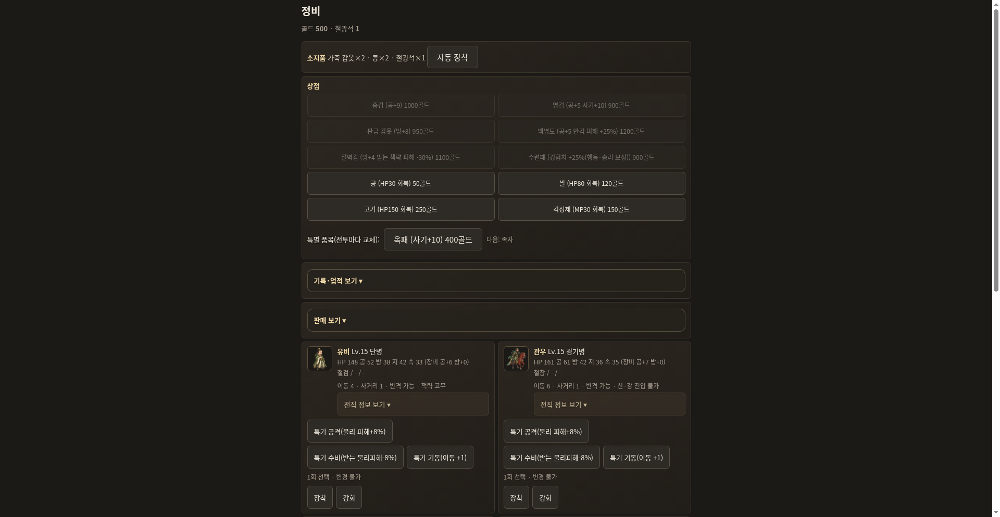
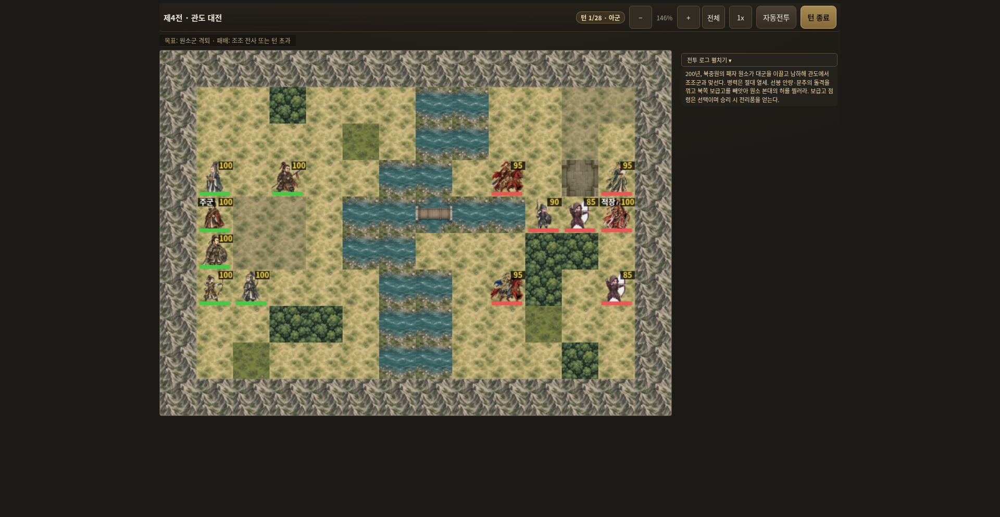

# 천하삼분 — 오리지널 삼국지 전술 RPG

삼국지 영걸전식 턴제 전술 RPG를 오리지널 시나리오·시스템으로 새로 기획한 웹 게임.
순수 HTML + Canvas + JavaScript로 만들어 빌드 없이 정적 호스팅만으로 동작한다.

**지금 플레이:** https://sigco3111.github.io/cheonha-sambun/

## 스크린샷

| 타이틀 | 전투 (유비군 제1전 · 탁현의 맹세) |
|---|---|
|  |  |

| 정비 (장착·강화·전직·상점) | 조조군 제4전 · 관도 대전 |
|---|---|
|  |  |

## 두 세력 전역 — 총 30전

시작 시 플레이할 세력을 고른다. 두 전역 모두 3부 구성이며, 부를 완주한 뒤 명시적으로 다음 부를 해금하는 방식이라 이전 완주 기록과 엔딩이 뒤바뀌지 않는다.

**유비군 (18전)**
- 1부 (1~9전): 탁현의 맹세 → 광종 공방 → 사수관의 화웅 → 호로관의 귀신 → 낙양 공성전 → 왕성 탈환 → 곽사의 최후 → 소패의 기습 → 하비의 함락
- 2부 (10~11전): 박망파의 복병 → 장판 후퇴전(12턴 방어전)
- 3부 (12~18전): 적벽 대전 → 남형주 4군 → 낙성 공략 → 익주 평정 → 정군산 → 이릉의 설욕(IF) → 북벌·낙양(IF) — 천하통일 엔딩

**조조군 (12전)**
- 1부 (1~4전): 연주 황건 토벌 → 연주 탈환 → 하비 포위 → 관도 대전
- 2부 (5~6전): 업 포위전 → 백랑산 결전
- 3부 (7~12전): 적벽 퇴각전 → 위남 대전 → 한중 양평관 → 정군산 방어(IF) → 남하 재기(IF) → 천하통일 결전(IF) — 천하통일 엔딩

3부 후반은 정사를 벗어난 IF(가상) 분기다. 유비군은 이릉의 패배를 설욕하고 낙양까지 북벌하는 세계선, 조조군은 적벽에서 물러난 뒤 다시 남하해 천하통일을 이루는 세계선을 그린다.

## 장수

- **유비군**: 유비·관우·장비·간옹·손건·미축으로 시작. 업적 조건을 채우면 관해·태사자·주창이 합류하고(IF), 3부에는 조운·제갈량·방통·위연·마초·황충이 정사 시점에 맞춰 편입된다. (최대 15명)
- **조조군**: 조조·하후돈·하후연·조인·악진·순욱으로 시작. 3부 한중 정벌부터 장합·주령·해표·고조가 편입된다. (최대 10명)
- 장수마다 AI가 생성한 전용 초상이 있고, 적 지휘관(장각·화웅·여포·원소·안량·문추·육손·사마의 등)도 초상이 적용된다.
- 합류 장수는 편입 순간 군단 평균 레벨로 1회만 계산되어 들어온다.

## 전투 시스템

- **턴제 전술**: 유닛 선택 → 이동(파란 타일) → 공격/책략/아이템/대기 → 턴 종료. 승리·패배 조건과 턴 제한은 전투마다 다르다(전멸전, 거점 사수, 생존 방어전 등).
- **지형 14종**: 평지·초원·숲·산·강·다리·습지·황무지·성내·성벽·관문·마을·병영·보물창고. 이동 비용과 방어 보정이 다르고, 마을·병영·성내는 매 턴 회복, 보물창고는 점령 시 추가 전리품. 산과 강은 병종별 진입 제한이 있다(수군은 강에서 기동).
- **기세(morale)**: 격파·아군 전사·턴 경과로 오르내리며 공격·방어에 직접 영향. 장신구와 책략으로도 조절한다.
- **책략**: 화계(범위 피해), 고무(기세 상승), 치유, 위협(기세 하강). 일부 전투에는 비가 내려 화계가 막히고 궁병 사거리가 줄어든다.
- **자동전투**: 전투 화면의 '자동전투' 버튼으로 위임 플레이. 속도 전환(1x/2x)과 줌·드래그 패닝 지원.
- **전장 정보**: 상단 목표 바(승리/패배 조건), 장수 카드(초상 + HP/MP 바), 접이식 전투 로그, PC 분할 레이아웃.

## 병종과 전직

4계열(보병·기병·궁병·책사)이 Lv.10과 Lv.20에서 전직 지침서를 소모해 3단계까지 올라간다. 3단계는 계열별 분기 전직이 있어 근위병/돌격병, 정예기병/철기병, 연노병/대궁수 중 하나를 고른다. 수군을 포함해 총 15개 클래스.

## 장비와 성장

- 무기·방어구·장신구 3슬롯, 상점 구매와 전리품으로 수집.
- 골드 + 철광석으로 장비 강화(최대 +5). 철광석은 전투 보상과 보물창고에서 얻는다.
- 정비 화면에서 장착·강화·전직·판매·자동 장착을 한 번에 처리한다.

## 다회차 요소

완주 후 다음 회차(cycle)를 시작할 수 있고, 회차마다 규칙이 달라진다.

- **회차 시작 보상**: 해금한 업적에 따라 회차 첫 전투 브리핑에서 보상 1가지를 고른다(군자금 800골드, 족자 등).
- **완주 기록**: 무결 완주(전사자 0), 신속 완주(모든 전투를 신속 목표 턴 내 클리어), 패퇴 후 재기 등의 기록이 엔딩에 남는다.
- **신속 목표 보너스**: 전투별로 정해진 턴 안에 이기면 추가 골드.
- **배치 변주**: 회차가 올라가면 일부 전투의 초기 배치와 거점 사수 구성이 바뀐다.
- **업적**: S 등급, 아홉 전투 정복, 질풍신뢰, 새로운 천하(2회차 진입) 등 — 후속 회차의 보상과 숨겨진 장수 합류(IF)의 해금 조건.

## 저장

localStorage 자동 저장 — 전투 승리 시마다 저장되고 타이틀의 '이어하기'로 이어서 한다. 세력·회차·루트·엔딩 이력이 모두 세이브에 보존되며, 손상된 세이브는 자동으로 덮어쓰지 않고 차단한다. 전투 중 새로고침하면 해당 전투는 처음부터 다시 시작한다.

## 조작

- 유닛 클릭 → 파란 타일 클릭으로 이동 → 행동 메뉴(공격/책략/아이템/대기) → 턴 종료.
- 마우스 드래그로 전장 패닝, 줌 버튼(+/-)과 '전체'로 배율 조절. 모바일은 터치 스크롤.

## 실행

정적 호스팅이면 어디든 가능. `index.html`을 여는 것으로 시작.
로컬: `python3 -m http.server 8000` 후 `http://localhost:8000/`.

### 개발용 URL 파라미터 (테스트)

- `?auto=1&battle=N&fast=1` — N전 자동전투 (결과가 document.title과 #test-result에 기록)
- `&faction=cao` — 조조군으로 시작 (미지정 시 유비군)
- `&level=N` — 테스트용 레벨 주입, `&screen=base` — 정비 화면 직행
- `&deploy=1` — 자동 없이 배치만, `&script=1~7` — 조작/전환/장착·강화·전직·줌 시나리오 테스트

## 에셋

모든 그래픽은 자체 생성한 AI 이미지 시트를 잘라 재배치한 것이다(지형 타일, 병종 스프라이트, 장수 초상). 외부 게임·저작물의 이미지를 가져오거나 복사한 것은 없다.

## 참고

시스템과 시나리오 구조의 영감은 삼국지 영걸전에서 얻었지만, 코드·대사·맵·이벤트는 전부 오리지널이다.
